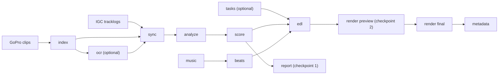

# Pipeline overview



Each step reads the outputs of the previous ones from `work/<name>/` and caches its own.
`--force` recomputes a step.

| Step | Does | Writes |
|---|---|---|
| `index` | ffprobe metadata; GPMF gyro/accel reduced to 10 Hz signals (yaw rate, shake, jerk) | `index.json`, `telemetry/*.npz` |
| `recover CLIP.MP4 [ref=OK.MP4]` | rebuilds a clip whose `moov` atom is missing ([details](recover-moov.md)) | `recovered/` |
| `tasks` | competition tasks from the configured provider | `<tasks_dir>/taskN.yaml` |
| `ocr` | reads the instrument clock in sampled frames (macOS) | `ocr.json` |
| `sync` | places each clip on the IGC timeline ([details](sync-without-gps.md)) | `sync.json` |
| `analyze` | per-clip visual/audio features at 2 fps from the LRV proxies; glider detection | `visual/`, `gliders/` |
| `score` | 1 Hz feature timelines, category scores, candidate segments ([details](highlight-scoring.md)) | `timeline/`, `segments.json` |
| `report` | timeline plots, contact sheets and sync table per day | `output/<name>/report/` |
| `beats` | tempo, beats, downbeats, energy and drops per track ([details](beat-sync.md)) | `music.json` |
| `edl` | automatic edit decision lists for the long video and the Short | `edl/long.yaml`, `edl/short.yaml` |
| `render` | builds the videos (`preview` 720p from proxies, or `final`) | `output/<name>/*.mp4` |
| `metadata` | titles, description with chapters, tags, thumbnails | `output/<name>/youtube/` |

## The two checkpoints

1. **Report** (`pgvid report`). Check the sync table (every clip should be `high`/`medium`)
   and look through the contact sheets. If the best launch or landing was missed, add a `pins:`
   entry. If a range is bad (a lens covered by a glove, the wrong camera), add an `exclude:`
   entry. Then re-run `score`.
2. **Previews** (`pgvid render long short`). Watch the 720p cuts. Edit the EDL YAML by hand
   and re-render: only changed segments are rebuilt. `pgvid edl --force` regenerates the EDL
   from scratch and **discards hand edits**.

## Chapters

The long video has one chapter per flying day (one IGC file = one day):

- With `competition:` data, a day is matched to its task by date (falling back to flying
  order). The card shows the task (distance, type, start, turnpoints, pilots in goal) and
  your result if `pilot` matches a name in the results.
- Without it, the chapter is "FLIGHT N". The card shows the flown distance, airtime and max
  altitude, and the map shows only your track.

## EDL format

```yaml
kind: long            # or short
width: 3840
height: 2160
duration: 421.3
music:                # timeline placement of tracks
  - {track: "Title - Artist", file: ..., in: 0.0, start: 0.0, end: 95.0, fade_in: 0.0, fade_out: 2.0}
chapters:             # used for the YouTube chapter list
  - {day: 0, task: 1, title: "Task 1", start: 20.1}
shots:                # contiguous: each shot starts where the previous one ends
  - type: clip
    clip: GX010123.MP4
    in: 61.2          # source in-point (s)
    start: 24.4       # timeline position (s)
    dur: 4.1          # timeline duration (s)
    speed: 1.0        # 1.5 = sped-up glide
    overlay: hud      # hud | title | lower_third | endscreen | caption, combine with '+'
    caption: "TEXT"   # for the caption overlay
    audio: low        # camera audio: up | low | mute (music ducks under 'up')
    fade_in: 0.35
    fade_out: 0.0
    stabilize: false  # ffmpeg deshake (final render only)
    crop: auto        # Short: horizontal crop follows detected gliders
  - type: card        # animated chapter card with map
    day: 1
    start: 98.0
    dur: 7.0
```

## Task file schema

Written by the `airtribune`/`xctsk` providers, or by hand with `provider: manual`:

```yaml
num: 1
date: "2026-07-14"
title: "Task 1"
type: "Race to goal"
distance_km: 84.2
start_time: "13:00"
turnpoints:
  - {type: TAKEOFF, lat: 46.1, lon: 7.2, radius_m: 400, id: TO}
  - {type: SSS, lat: 46.2, lon: 7.3, radius_m: 3000}
  - {type: TP, lat: 46.3, lon: 7.5, radius_m: 1000}
  - {type: ESS, lat: 46.1, lon: 7.6, radius_m: 1000}
  - {type: GOAL, lat: 46.1, lon: 7.6, radius_m: 400}
pilots: 120
stats: {no_of_pilots_reaching_goal: 64}
result: {rank: 42, time: "2:31:10", distance_km: 84.2}
```

## Configuration

Every option is shown and commented in
[examples/example_project.yaml](../examples/example_project.yaml). Text options are
`{placeholder}` templates. Only plain field names are allowed, and unknown fields render
empty.

## Tips

- A step that fails because its input is missing means an earlier step hasn't run yet.
- Rendering uses VideoToolbox hardware decoding on macOS and software decoding elsewhere.
- Final renders are x264 CRF 17, so 4K masters are large. YouTube re-encodes them anyway.
